# Photon transport experiments

Every example is self-contained. Outputs are created in the current working directory.
`examples/render-all.sh` rebuilds this gallery with lmparticle → CSV → lmplot or lmcad.

## Finite lead shields

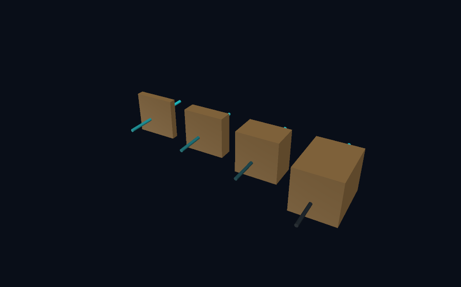

Four separate 1.5 × 1.5 cm shields with thicknesses 0.25, 0.5, 1 and 2 cm from left to right. Exit-beam brightness encodes computed uncollided transmission; beam shapes are schematics, not sampled photon tracks.

[Example](../examples/visual/shield_geometry.lms) · `lmctl https://raw.githubusercontent.com/lmctl-ai/lmparticle/main/examples/visual/shield_geometry.lms`

## Materials across photon energy

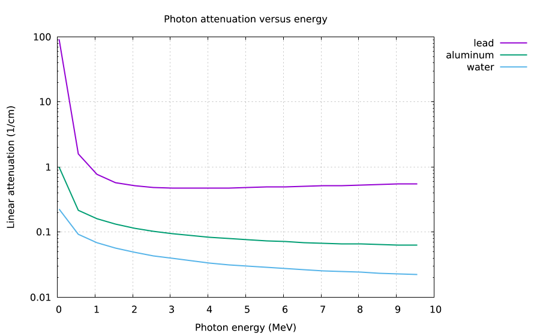

Water, aluminum and lead attenuation coefficients from the embedded XCOM data.

[Example](../examples/visual/material_attenuation.lms) · `lmctl https://raw.githubusercontent.com/lmctl-ai/lmparticle/main/examples/visual/material_attenuation.lms`

## Competing interaction processes

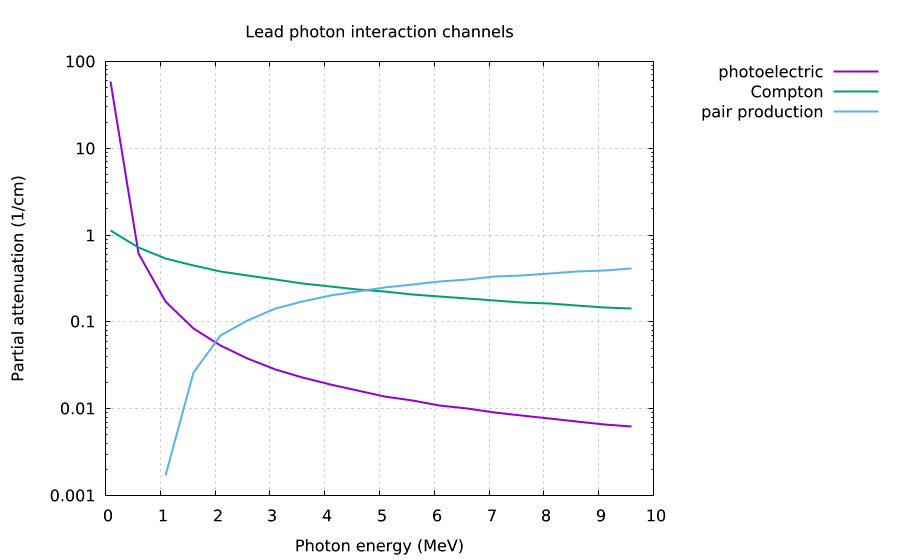

Lead photoelectric, Compton and pair-production coefficients across energy.

[Example](../examples/visual/interaction_crossover.lms) · `lmctl https://raw.githubusercontent.com/lmctl-ai/lmparticle/main/examples/visual/interaction_crossover.lms`

## How much material halves a beam?

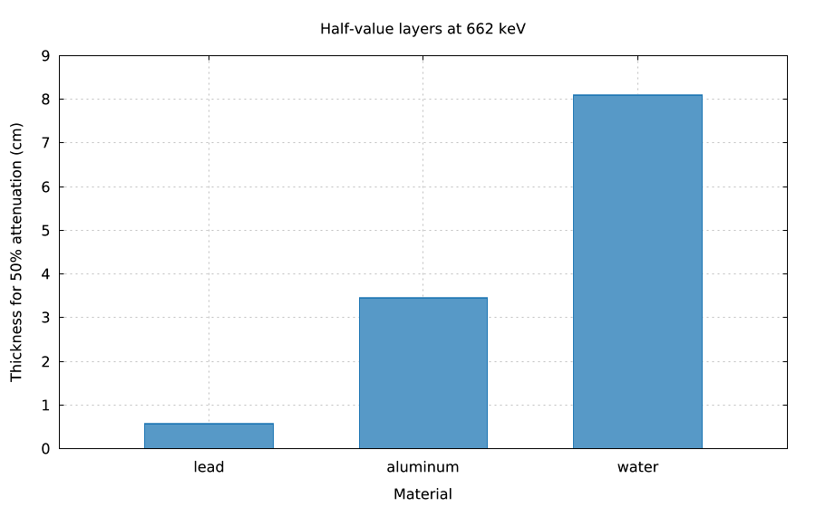

Half-value layers at 662 keV compare equal attenuation, not equal mass or cost.

[Example](../examples/visual/half_value_layers.lms) · `lmctl https://raw.githubusercontent.com/lmctl-ai/lmparticle/main/examples/visual/half_value_layers.lms`

## Compton energy transfer

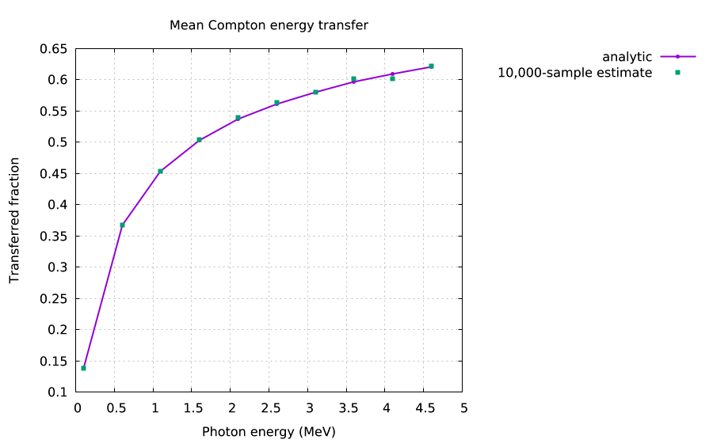

Seeded scattering samples compared with the analytic mean energy transfer.

[Example](../examples/visual/compton_transfer.lms) · `lmctl https://raw.githubusercontent.com/lmctl-ai/lmparticle/main/examples/visual/compton_transfer.lms`

## Scatter buildup behind lead

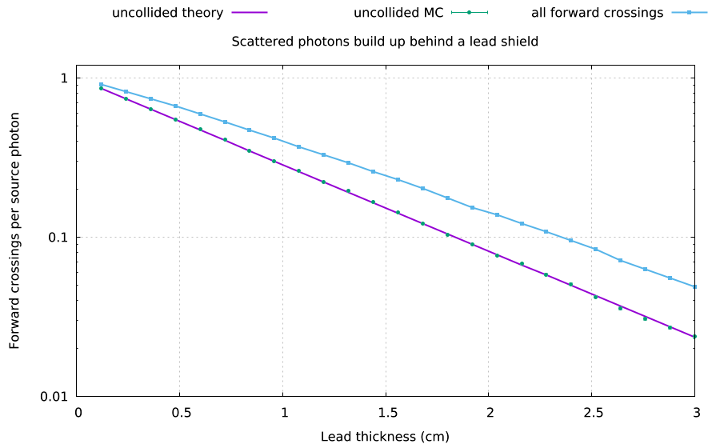

Uncollided transmission follows exp(-mu x); all forward plane crossings also include scattered photons and are not a survival probability.

[Example](../examples/visual/shield_buildup.lms) · `lmctl https://raw.githubusercontent.com/lmctl-ai/lmparticle/main/examples/visual/shield_buildup.lms`

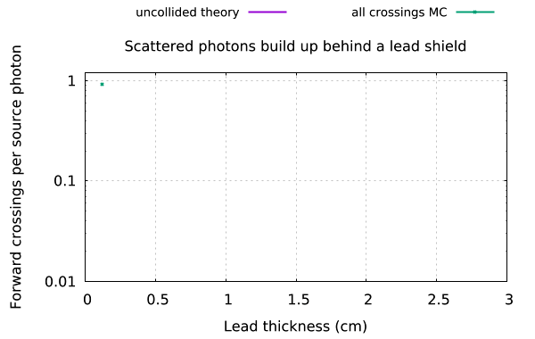

25 computed thickness points revealed at 8 fps, with fixed axes. `lmctl https://raw.githubusercontent.com/lmctl-ai/lmparticle/main/examples/visual/shield_buildup.lms`

## Water removes softer photons first

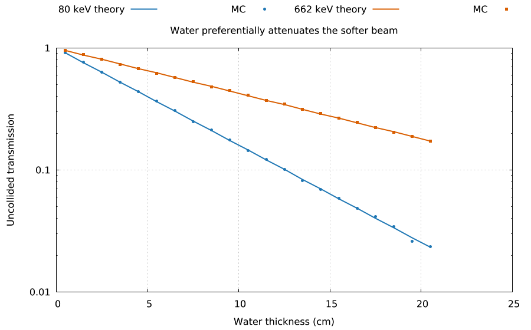

Separate 80 and 662 keV monochromatic probes isolate preferential attenuation; lines are theory and points are Monte Carlo.

[Example](../examples/visual/water_hardening.lms) · `lmctl https://raw.githubusercontent.com/lmctl-ai/lmparticle/main/examples/visual/water_hardening.lms`

## Order matters for energy deposition

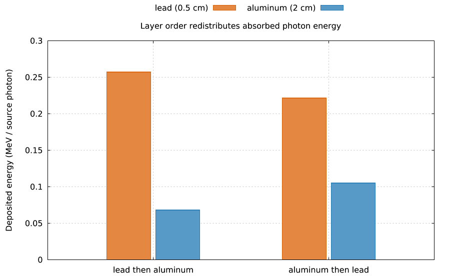

Reversing lead and aluminum layers preserves uncollided attenuation but changes where the beam deposits its energy. Charged particles deposit locally in this model.

[Example](../examples/visual/layer_order.lms) · `lmctl https://raw.githubusercontent.com/lmctl-ai/lmparticle/main/examples/visual/layer_order.lms`

## Tenth-value layers for Cs-137 and Co-60

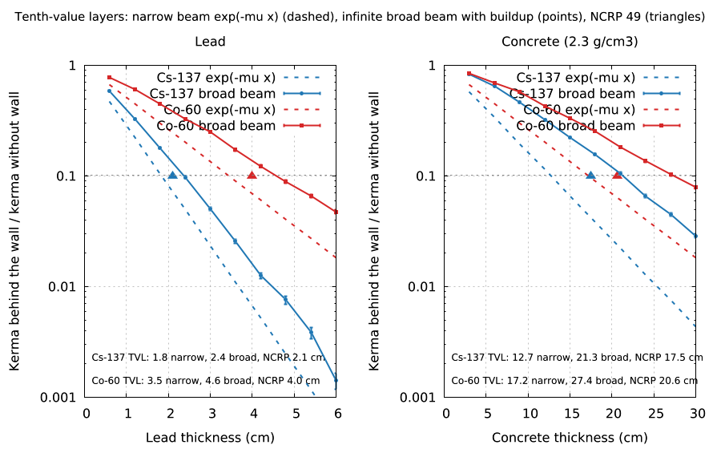

Kerma behind a lead or concrete wall against thickness: the narrow-beam exp(-mu x) tables understate the wall, because scattered photons add a third (lead) to two thirds (concrete) to the tenth-value layer. NCRP 49 values are marked as triangles.

[Example](../examples/visual/tenth_value_layers.lms) · `lmctl https://raw.githubusercontent.com/lmctl-ai/lmparticle/main/examples/visual/tenth_value_layers.lms`

## Source in a lead pot: kerma against distance

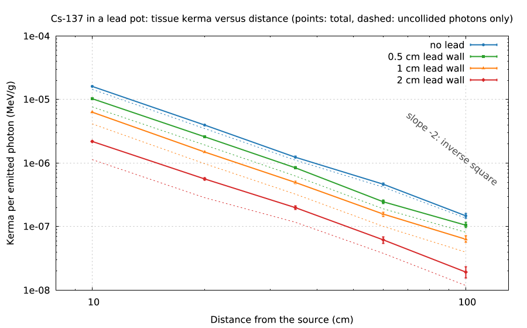

Tissue kerma per emitted Cs-137 photon from 10 cm to 1 m behind 0, 0.5, 1 and 2 cm of lead: inverse square times exp(-mu t) (dashed, uncollided only), plus what scatters out of the lead and off the air.

[Example](../examples/visual/dose_rate_distance.lms) · `lmctl https://raw.githubusercontent.com/lmctl-ai/lmparticle/main/examples/visual/dose_rate_distance.lms`

## Streaming through a slit

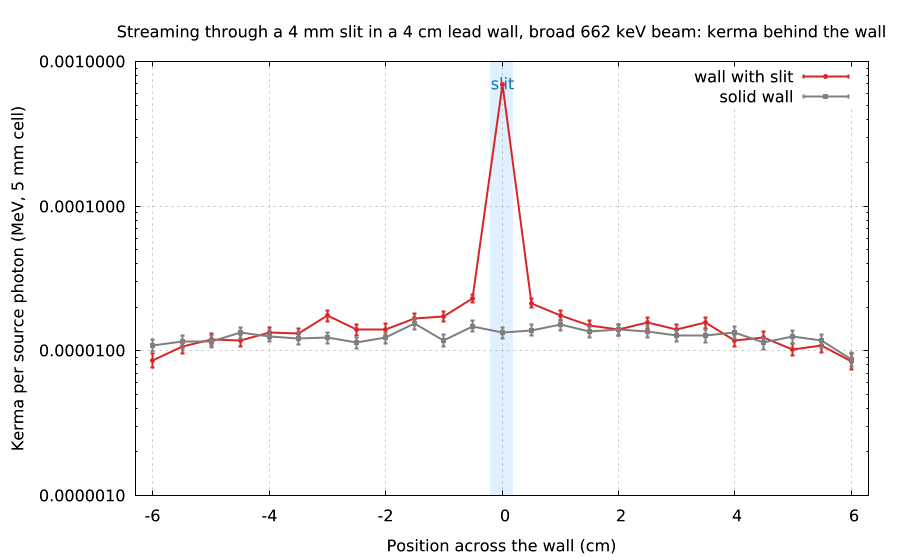

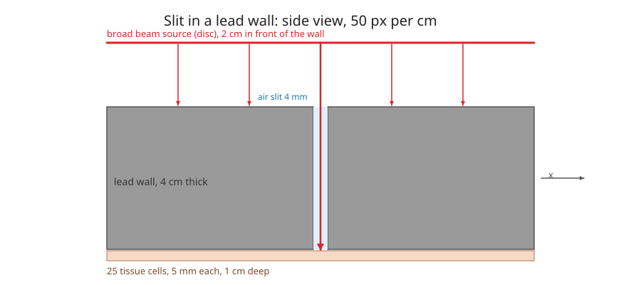

A 4 mm air slit in a 4 cm lead wall under a broad 662 keV beam passes about 50 times the kerma of the solid wall next to it, measured in 25 tissue cells behind the wall. The layout, to scale, is drawn by lmdraw.

[Example](../examples/visual/streaming_gap.lms) · `lmctl https://raw.githubusercontent.com/lmctl-ai/lmparticle/main/examples/visual/streaming_gap.lms`

## NaI(Tl) detector efficiency

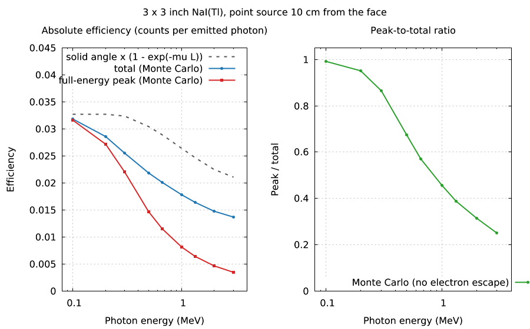

A 3 x 3 inch crystal 10 cm from a point source: total and full-energy-peak efficiency from 0.1 to 3 MeV against the geometric estimate, solid angle times (1 - exp(-mu L)), and the peak-to-total ratio (no electron escape in this model).

[Example](../examples/visual/nai_efficiency.lms) · `lmctl https://raw.githubusercontent.com/lmctl-ai/lmparticle/main/examples/visual/nai_efficiency.lms`

## Backscatter peak in a Cs-137 spectrum

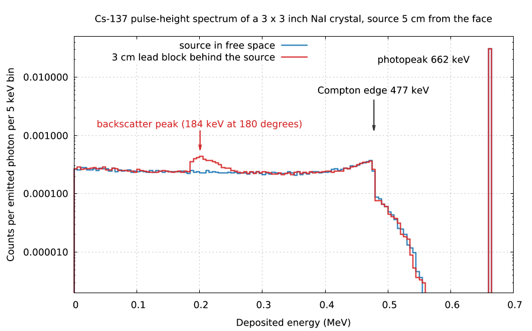

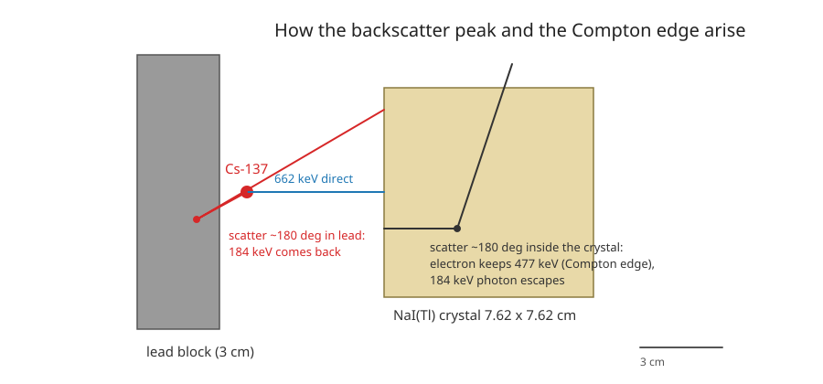

A 3 cm lead block behind the source adds the 184 keV backscatter bump to the NaI pulse-height spectrum; the Compton edge stays at 477 keV. The lmdraw diagram shows the two 180-degree scatters that make the two features.

[Example](../examples/visual/backscatter_peak.lms) · `lmctl https://raw.githubusercontent.com/lmctl-ai/lmparticle/main/examples/visual/backscatter_peak.lms`

## Radiographic contrast of bone

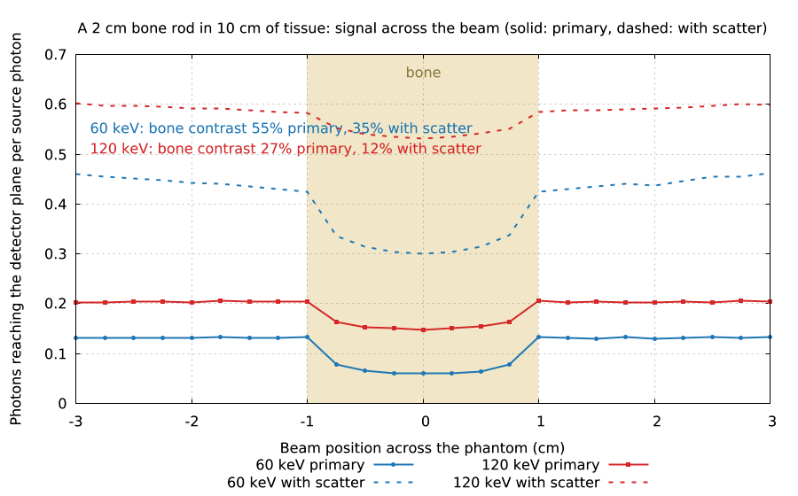

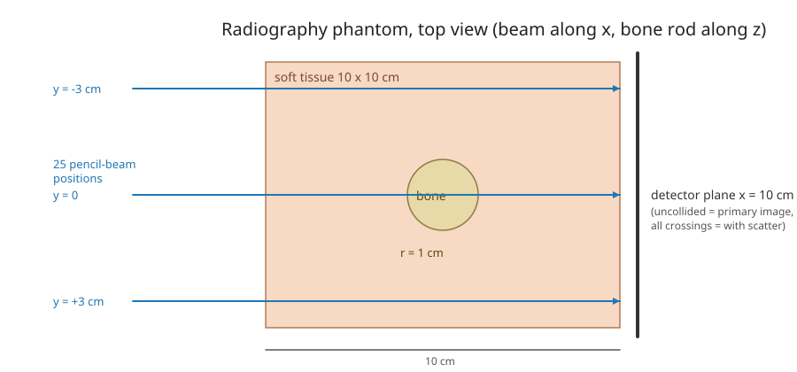

25 pencil beams across a 2 cm bone rod in 10 cm of tissue: 55 percent contrast at 60 keV, 27 percent at 120 keV for the primary image, and scatter fog halves both. The phantom and detector plane are drawn by lmdraw.

[Example](../examples/visual/radiography_contrast.lms) · `lmctl https://raw.githubusercontent.com/lmctl-ai/lmparticle/main/examples/visual/radiography_contrast.lms`

## X-ray tube filtration

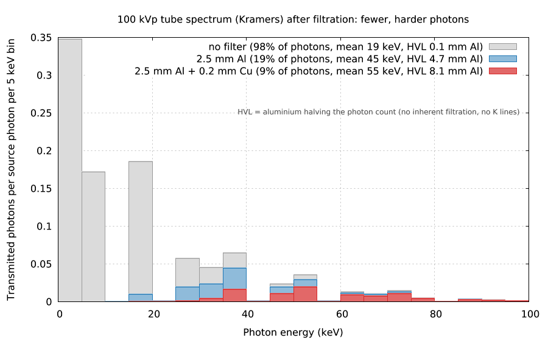

A 100 kVp Kramers spectrum after 2.5 mm Al and after 2.5 mm Al + 0.2 mm Cu: the soft photons go, the mean energy rises from 19 to 55 keV and the aluminium half-value layer from 0.1 to 8.1 mm.

[Example](../examples/visual/tube_filtration.lms) · `lmctl https://raw.githubusercontent.com/lmctl-ai/lmparticle/main/examples/visual/tube_filtration.lms`

## Photon tracks

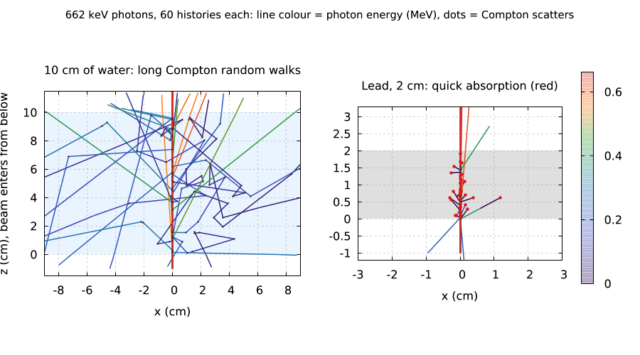

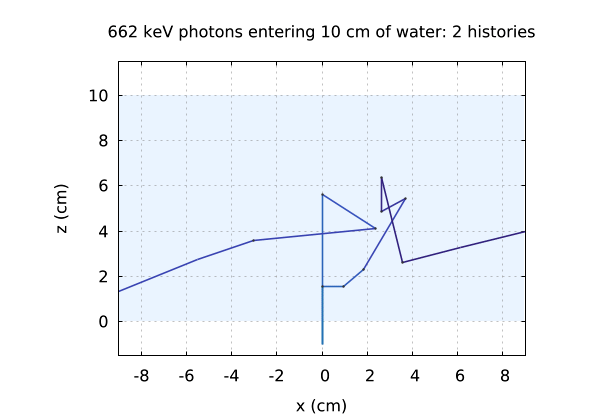

60 recorded histories of 662 keV photons in 10 cm of water (long Compton random walks) and 2 cm of lead (quick absorption), coloured by energy; the animation adds two histories per frame.

[Example](../examples/visual/photon_tracks.lms) · `lmctl https://raw.githubusercontent.com/lmctl-ai/lmparticle/main/examples/visual/photon_tracks.lms`

## Which interaction dominates

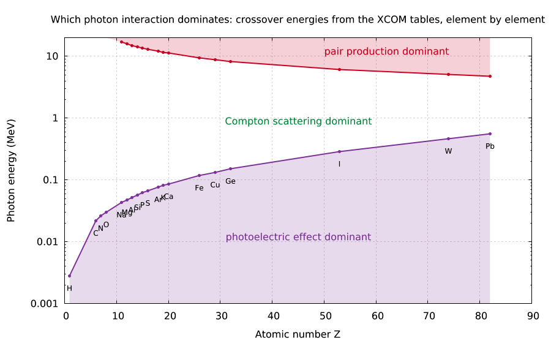

Crossover energies from the XCOM tables for all 19 elements: photoelectric below the lower curve, pair production above the upper one, Compton scattering in between.

[Example](../examples/visual/dominance_map.lms) · `lmctl https://raw.githubusercontent.com/lmctl-ai/lmparticle/main/examples/visual/dominance_map.lms`

## Buildup factor against depth

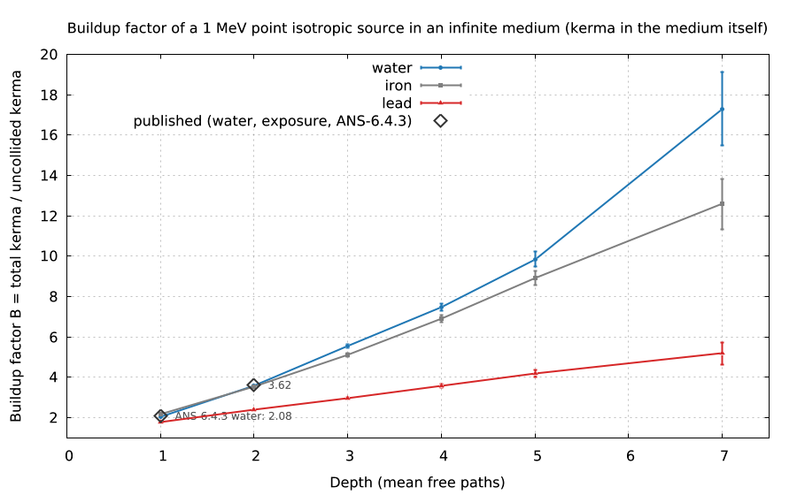

A 1 MeV point isotropic source in infinite water, iron and lead: total over uncollided kerma at 1 to 7 mean free paths; water gives 2.09 and 3.59 at 1 and 2 mfp against the published 2.08 and 3.62 (ANS-6.4.3).

[Example](../examples/visual/buildup_factor.lms) · `lmctl https://raw.githubusercontent.com/lmctl-ai/lmparticle/main/examples/visual/buildup_factor.lms`

## Monte Carlo convergence

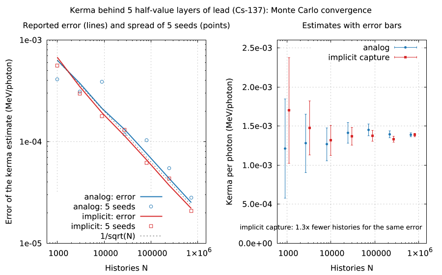

Kerma behind five half-value layers of lead: the reported error and the spread of five seeds both fall as 1/sqrt(N); implicit capture needs 1.3 times fewer histories for the same error.

[Example](../examples/visual/convergence.lms) · `lmctl https://raw.githubusercontent.com/lmctl-ai/lmparticle/main/examples/visual/convergence.lms`

## Original simulations

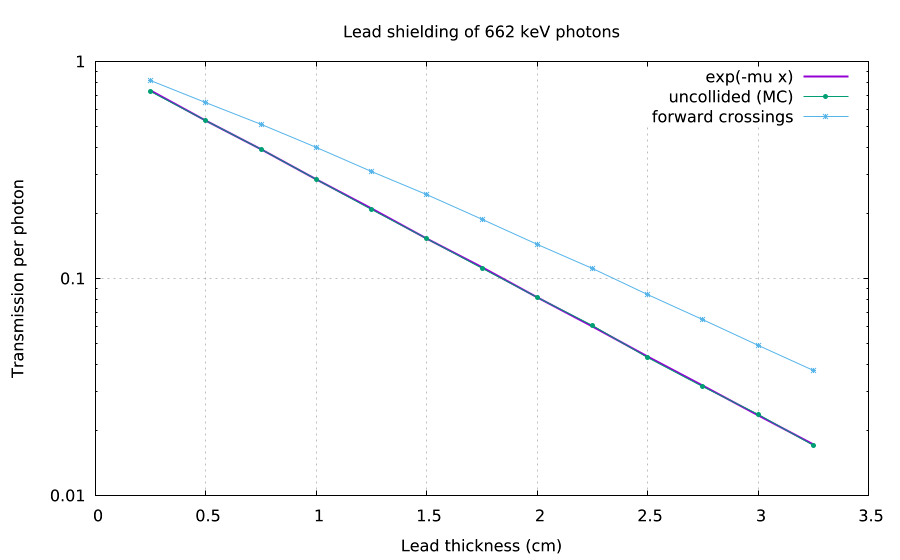

[Example](../examples/shielding.lms) · `lmctl https://raw.githubusercontent.com/lmctl-ai/lmparticle/main/examples/shielding.lms`

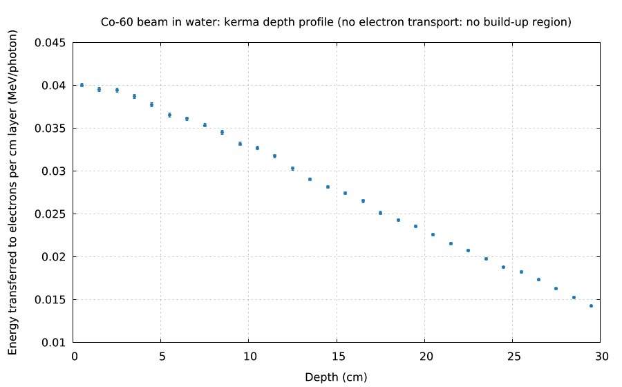

[Example](../examples/depth_dose.lms) · `lmctl https://raw.githubusercontent.com/lmctl-ai/lmparticle/main/examples/depth_dose.lms`

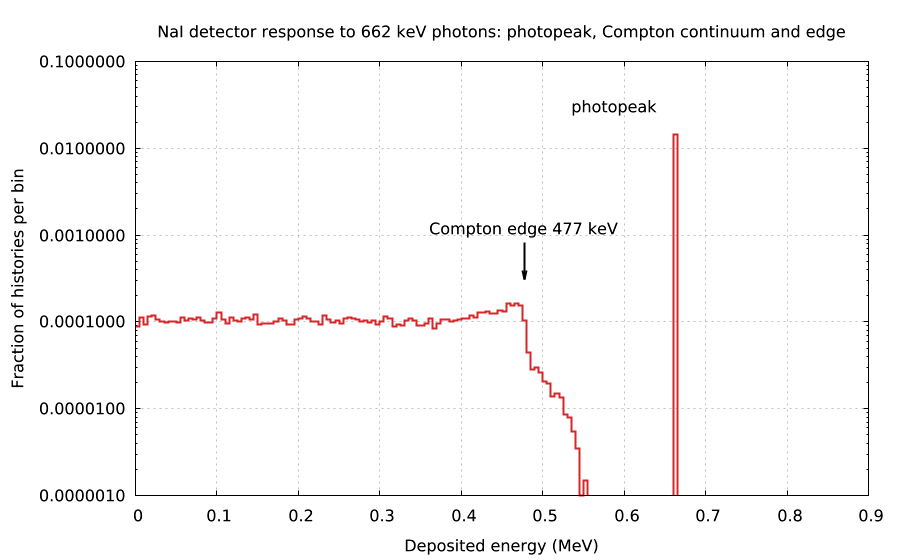

[Example](../examples/detector_response.lms) · `lmctl https://raw.githubusercontent.com/lmctl-ai/lmparticle/main/examples/detector_response.lms`

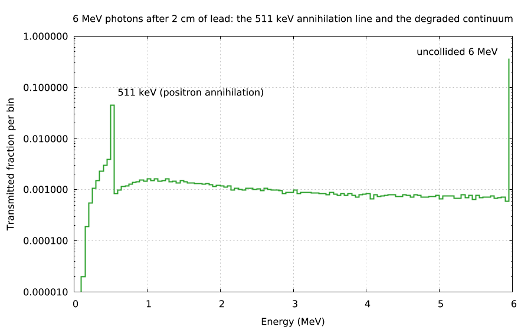

[Example](../examples/pair_spectrum.lms) · `lmctl https://raw.githubusercontent.com/lmctl-ai/lmparticle/main/examples/pair_spectrum.lms`

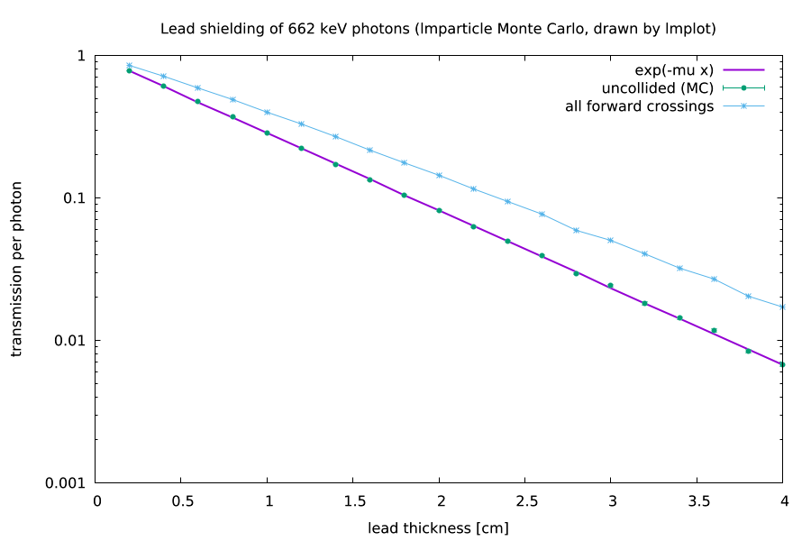

[Example](../examples/combo/shielding_plot.lms) · `lmctl https://raw.githubusercontent.com/lmctl-ai/lmparticle/main/examples/combo/shielding_plot.lms`

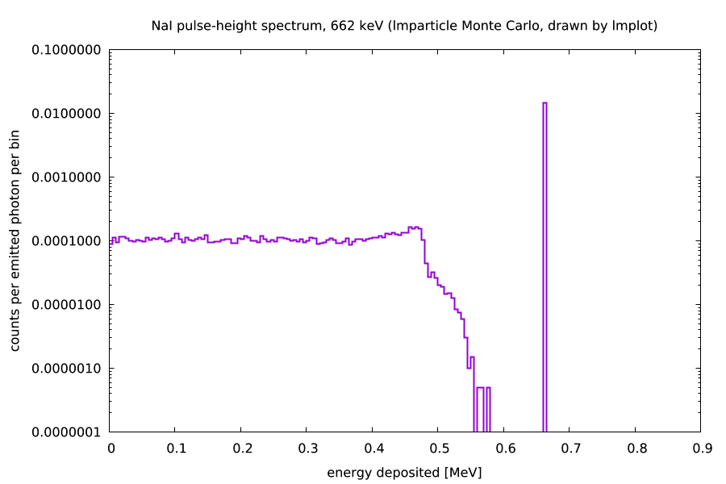

[Example](../examples/combo/detector_spectrum.lms) · `lmctl https://raw.githubusercontent.com/lmctl-ai/lmparticle/main/examples/combo/detector_spectrum.lms`

The transport model uses local charged-particle energy deposition (kerma); see the [physics limits](../durable-memory/03-physics-and-limits.md).
